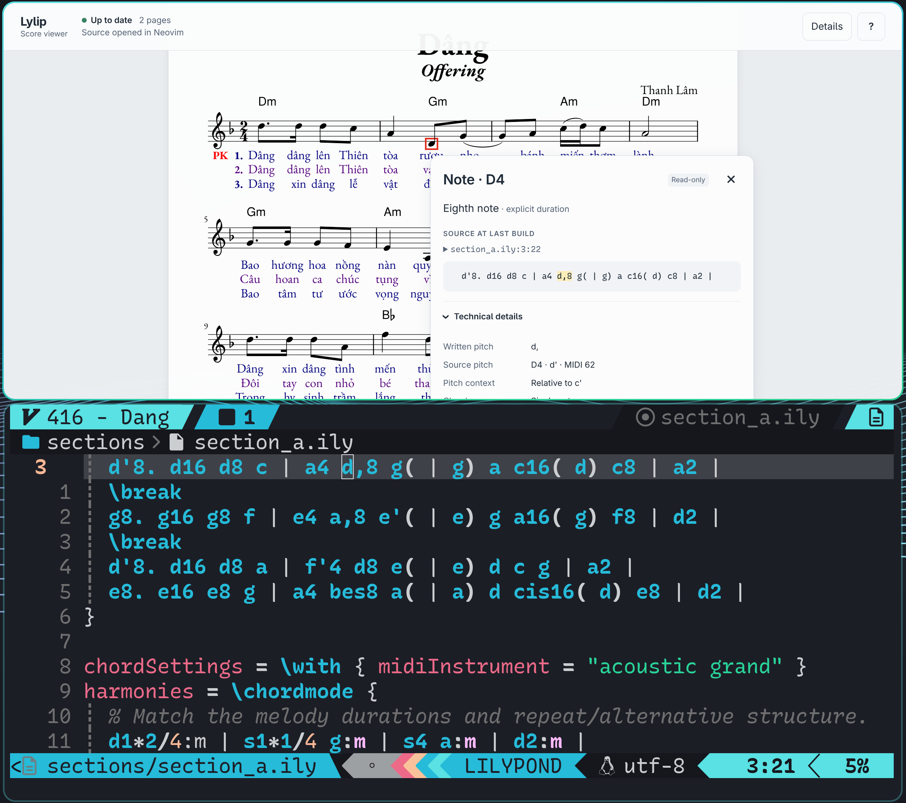

# Lylip

A LilyPond plugin for Neovim. Create scores, adjust the layout, jump between notes and source, and export PDFs.



Inspect a note in the score and find it in the source. [Watch the 21-second demo](media/screenrecording-2026-10-27_19-01-08.mp4).

## Features

- Start with piano, single-staff, SATB, or two-staff choir presets. Add sections, lyrics, and instruments.
- Adjust fonts, spacing, margins, and colors for the whole score or a section.
- Preview layout changes before applying them. Lylip checks that the MIDI stays unchanged.
- View SVG scores in Chrome or Chromium. Click a note to find its source, or highlight a source note in the score.
- Transpose selected music, review source diffs, and save Git milestones.
- Build a PDF when you're ready to print or share.

You write the music in LilyPond. Layout edits preserve notes, lyrics, repeats, instruments, section order, and handwritten breaks.

## Why SVG

SVG lets the viewer work directly with notes and other score elements. It can highlight them, show details, link back to source, and select groups for chord suggestions. The working viewer needs no PDF parsing or conversion to page images.

The viewer is a small web app built with plain HTML, CSS, and JavaScript. That makes it easy to add tools, overlays, and new interactions around the score. SVG keeps the working view flexible; PDF is there for printing and sharing.

## Requirements

- Neovim 0.11+ with LuaJIT
- LilyPond 2.26
- libyaml 0.2 and Poppler's `pdftoppm` for layout editing and import
- Chrome or Chromium for the SVG viewer

Optional: Telescope for pickers, Git for history, ripgrep for project discovery, and Fontconfig for browsing installed fonts. Audio features need a separate SoundFont and playback tools. LilyPond's bundled fonts work with the default settings.

## Install

With lazy.nvim:

```lua
{
  'nkarl/lilyp.nvim',
  tag = 'v0.1',
  config = function()
    require('lilyp').setup({
      navigation = { enabled = true },
    })
  end,
}
```

Run `:checkhealth lilyp`, then open `:Lylip`.

If you use Telescope, load the extension after configuring it:

```lua
require('telescope').load_extension('lilyp')
```

## Use

| Command | Action |
| --- | --- |
| `:Lylip` | Create or open a score project |
| `:Lylip [path]` | Open a project or included source file |
| `:Telescope lilyp new_score` | Create a score |
| `:Telescope lilyp configure` | Edit the current project's layout |
| `:LylipReview` | Review source changes and Git milestones |
| `:LylipBuild` | Build the working SVG score |
| `:LylipView` | Open the score viewer |
| `:LylipPublishPDF` | Build a PDF |
| `:LylipViewPDF` | Open the PDF |

In the workspace, press `?` for help. Use `/` to find a setting, `h`/`l` to adjust it, and Enter to type a value. In layout editing, `d` shows the diff, `p` previews a PDF, and `a` applies the draft. Press `q` to close and discard drafts. Opening and previewing do not change project files.

With navigation enabled, F7 highlights the source note in the viewer. To transpose, select music in Visual mode, press `:`, clear the range with Ctrl+U, and run `Telescope lilyp transpose`. Choose a destination such as `fis'`. Use `u` to undo. Unsupported music is rejected before editing.

## Configure

New-score defaults can be changed in `setup()`:

```lua
require('lilyp').setup({
  defaults = {
    tempo = 100,
    lyrics = true,
    style = { staff_size = 18, lyric_size = 2 },
  },
  build_location = 'project', -- Keep output in the score's build/ directory.
  navigation = { enabled = true },
})
```

These defaults apply to new scores. Existing projects keep their own settings. Output uses temporary storage unless the project or setup selects local storage; copy finished files elsewhere to keep them.

## nvim-lilypond-suite integration

[nvim-lilypond-suite](https://github.com/martineausimon/nvim-lilypond-suite) adds LilyPond syntax support, lyric hyphenation, and an audio player. Lylip connects its build and viewer commands to your score project, so you can work in an included section file and still build or play the main score.

Replace the minimal lazy.nvim entry above with this one. The dependency configures `nvls` before Lylip enables its adapter:

```lua
{
  'nkarl/lilyp.nvim',
  tag = 'v0.1',
  dependencies = {
    {
      'martineausimon/nvim-lilypond-suite',
      config = function()
        require('nvls').setup({})
      end,
    },
  },
  config = function()
    require('lilyp').setup({
      build_integration = true,
      navigation = { enabled = true },
    })
  end,
}
```

If you already configure the suite, keep your existing `nvls.setup()` options and load it before `lilyp.setup()`. Configure each plugin once. Without lazy.nvim, call the two setup functions in that order.

### Build, view, and play

Open a saved `.ly` or `.ily` file in your project. With the suite's default mappings:

| Key | Action |
| --- | --- |
| F5 | Save the score sources and build SVG plus MIDI |
| F6 | Open the SVG viewer; later builds refresh it |
| F3 | Convert the built MIDI to audio and open the suite's player |
| F7 | Highlight the source note in the viewer |
| F8 | Build a PDF for printing or sharing |

F7 and F8 are added only when those keys are unbound. F5, F6, and F3 follow the suite's mapping settings. You do not need to configure a PDF viewer for the SVG workflow.

Create a score with MIDI enabled, press F5, then F6. Press F3 when you want to hear the last build; rebuild after editing the music. The adapter keeps the build, viewer, and player paths together, including when you work inside `sections/`.

### Set up audio

For the FluidSynth playback path, install `fluidsynth`, `ffmpeg`, `mpv`, and a General MIDI SoundFont (`.sf2`). FluidSynth renders the MIDI, FFmpeg converts the audio, and MPV plays it. These tools are separate from the plugin.

Replace `require('nvls').setup({})` in the dependency above with:

```lua
require('nvls').setup({
  player = {
    options = {
      midi_synth = 'fluidsynth',
      audio_format = 'wav',
      fluidsynth_flags = {
        '-i', '-r', '44100', '-g', '0.2',
        '/path/to/General-MIDI.sf2', -- Replace with your installed SoundFont.
      },
      ffmpeg_flags = { '-y', '-ar', '44100' },
    },
  },
})
```

Use a real, absolute SoundFont path. The 44.1 kHz setting keeps FluidSynth's output aligned with the converter. You can skip audio setup and still create scores, edit layout, view SVG, and export PDFs. See the suite's [installation guide](https://github.com/martineausimon/nvim-lilypond-suite/wiki/1.-Installation) and [configuration guide](https://github.com/martineausimon/nvim-lilypond-suite/wiki/2.-Configuration) for other playback options.

### Check the setup

Restart Neovim after changing the load order, open a LilyPond file, and run `:checkhealth lilyp`. If F5 or F6 still uses the old PDF workflow, check that the suite loads first and `build_integration = true` is set. If F3 has no MIDI to play, enable MIDI in the score and build it first. If audio conversion fails, check the external tools and SoundFont path.

The core Lylip commands work without the suite; the integration is optional.

## Existing scores

Projects use `score.yaml` with `kind: lilypond-score`, a main source (`main.ly` by default), and a style source (`style.ily` by default). New Score creates this structure for you.

YAML stores the layout settings you choose to manage. Custom LilyPond code is preserved; ambiguous styling needs manual editing. Apply validates changes and rolls back caught write failures, but a crash can leave a partial update. Keep your scores in version control.
